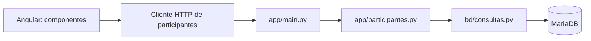
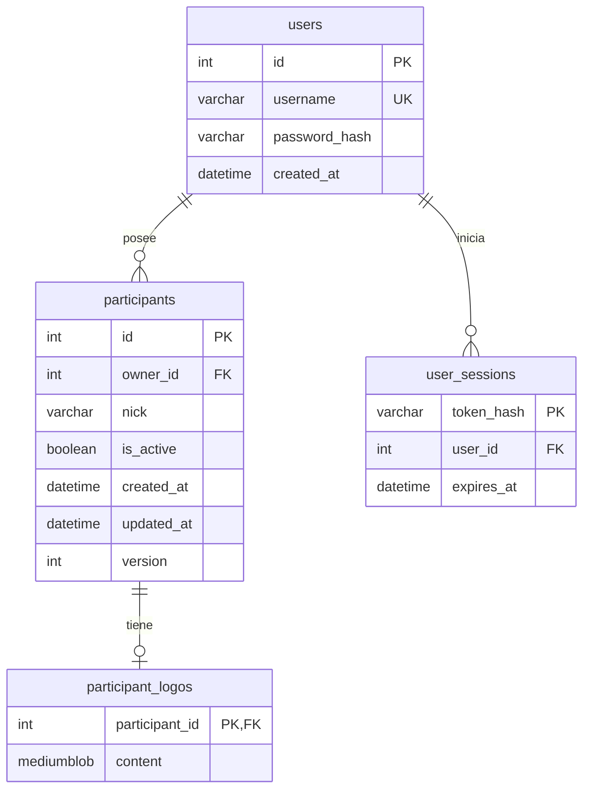
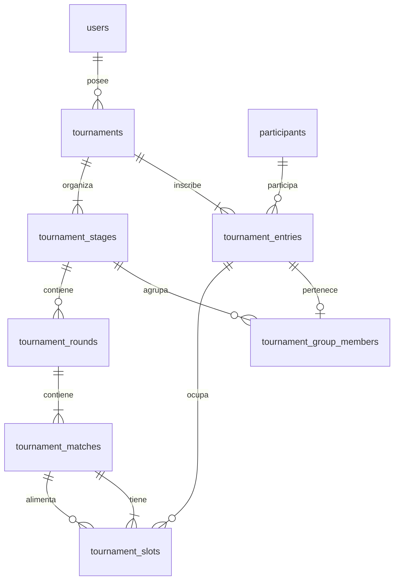

# Arquitectura y modelo de datos

## Flujo

Angular no conoce credenciales ni SQL. El backend valida todas las entradas y es la única vía de acceso de la aplicación a la base de datos. Los contratos HTTP están separados de los modelos persistentes. Las consultas se construyen con SQLAlchemy y parámetros, sin interpolar entradas en SQL.

## Entidades implementadas

`participants.id` es la clave primaria estable; `(owner_id, nick)` es una clave alternativa única. El propietario es obligatorio y referencia `users.id`. Todas las lecturas y modificaciones se restringen al propietario autenticado. Todas las columnas describen exclusivamente ese participante. `is_active` es un estado binario, no un catálogo de estados. Las marcas temporales se almacenan en UTC; `version` es el contador de concurrencia.

`participant_logos.participant_id` es simultáneamente clave primaria y foránea. Garantiza como máximo un logo por participante y evita logos huérfanos. Su único atributo no clave es el PNG del participante. La relación es opcional: la ausencia de fila indica que no existe logo. `ON DELETE CASCADE` asegura integridad ante una eliminación administrativa, aunque la API de esta fase solo permite desactivar.

Las tablas de jugadores y logos cumplen tercera forma normal: tienen atributos atómicos, cada atributo no clave depende de una clave completa y no existen dependencias transitivas entre atributos no clave. Los listados no cargan los bytes del logo: SQLAlchemy los carga únicamente al solicitar la imagen. No se repiten participantes, listas de IDs, contadores de victorias o datos de juegos en columnas de texto.

`schema_updates` es la tabla técnica que registra las versiones SQL aplicadas por `bd.preparar`; no es una entidad de negocio. `alembic_version`, procedente de la primera preparación, se conserva como historial y ya no se consulta. El motor es InnoDB y el juego de caracteres utf8mb4. MariaDB impone las restricciones además de las validaciones del backend.

## API

| Método | Ruta | Uso |
|---|---|---|
| GET | `/api/auth/session` | Recupera identidad y prepara cookie CSRF |
| POST | `/api/auth/register` | Crea cuenta e inicia sesión |
| POST | `/api/auth/login` | Inicia sesión |
| POST | `/api/auth/guest` | Abre sesión temporal |
| POST | `/api/auth/logout` | Revoca sesión; descarta datos invitados |
| GET | `/api/health` | Comprueba la conexión a MariaDB |
| GET | `/api/participants` | Lista paginada con `q`, `status`, `page`, `page_size` |
| GET | `/api/participants/{id}` | Consulta de un participante |
| POST | `/api/participants` | Alta, formulario multipart |
| PUT | `/api/participants/{id}` | Edición, formulario multipart con versión |
| PATCH | `/api/participants/{id}/state` | Activación/desactivación con versión |
| GET | `/api/participants/{id}/logo` | PNG del participante |

Los listados contienen `items`, `total` filtrado, `page`, `page_size` y `summary` de la cuenta o invitado. Máximo 48 filas por petición; Angular solicita 12. La búsqueda escapa comodines SQL. Un alta devuelve 201; duplicados y conflictos, 409; datos inválidos, 422; registros ausentes, 404; indisponibilidad de MariaDB, 503 con un mensaje sin detalles de conexión.

## Evolución prevista

La fase 2 añade torneos, inscripciones, fases, grupos, rondas, partidos y plazas de los partidos. Las fases futuras añadirán resultados y sus reglas mediante nuevas versiones SQL, conservando los identificadores ya guardados. No se han añadido tablas de juegos ni estadísticas: el diseño de torneos no depende de FC 27.

El sorteo y los pases libres ya están definidos. La fase 3 implementa avances, clasificación, desempates y finalización. Los resultados confirmados son inmutables. Las estadísticas se derivarán de resultados persistidos; no se añadirán contadores duplicados sin una estrategia explícita de actualización.

## Implementación sencilla

La carpeta app contiene la API (main.py), las operaciones y validaciones (participantes.py) y los datos de las peticiones y respuestas (datos.py). La carpeta bd contiene conexión, modelos, consultas y preparación SQL. No hay subcarpetas por capas ni clases intermedias de servicio o repositorio.

Las rutas llaman directamente a las funciones de app/participantes.py. Las consultas están en bd/consultas.py y los modelos en bd/modelos.py. La configuración y las sesiones se concentran en bd/conexion.py. El SQL versionado está en bd/preparar.py y la comprobación de tablas en bd/comprobar.py.

Se conservan las tablas, rutas y reglas. Las comprobaciones automáticas se mantienen en la carpeta pruebas de la raíz, apartadas del backend para retomarlas después. Consulta GUIA_BACKEND.md para una explicación archivo por archivo.
## Acceso y separación de datos

`app/sesiones.py` contiene funciones para registro, login, cookies, CSRF y caducidad. `require_access` es una dependencia global: salvo las rutas públicas de acceso y salud, se necesita identidad. Las rutas de jugadores reciben esa identidad y `bd/consultas.py` filtra tanto el ID como `owner_id`, incluidos los logos. Una cuenta ajena recibe 404; sin sesión se devuelve 401; un token CSRF ausente o incorrecto, 403. Hay límite de intentos de acceso por dirección y categoría.

`users` guarda un hash de contraseña con sal. `user_sessions` guarda únicamente el hash del token aleatorio de sesión, su usuario y caducidad. No se guardan contraseñas ni tokens de sesión en texto plano. `username` es único sin distinguir mayúsculas. La relación de sesiones elimina sus filas al retirar una cuenta; los jugadores usan RESTRICT para evitar eliminaciones accidentales.

`app/invitados.py` aplica las operaciones temporales sin persistencia en MariaDB. Guarda objetos en un diccionario de memoria identificado por el hash de la sesión. Máximo 50 invitados simultáneos, 32 jugadores por invitado y 32 MiB de logos temporales en total. Caducan a las 2 horas y al reiniciar el backend. Esta implementación local usa un solo proceso de Uvicorn; varios procesos necesitarían un almacén temporal compartido. No se añaden carpetas al backend.

Angular controla la pantalla de acceso mediante `features/access`: servicio de identidad, componente de acceso e interceptor para volver al acceso al recibir 401. Para invitados usa un indicador por pestaña en sessionStorage (no guarda el token allí). El cierre normal pierde ese indicador; una restauración de pestañas del navegador puede recuperarlo, por lo que no garantiza purga inmediata. Consulta README para el ciclo de vida completo.

Las funciones futuras deben recibir la identidad, filtrar por propietario y decidir su almacenamiento en modo invitado. La dependencia global exige acceso, pero la autorización de cada recurso debe aplicarse en sus consultas.

## Torneos: fase 2

- `tournaments`: propietario, nombre, formato, mínimo, máximo, fecha e identificador de envío. El recuento se deriva de las inscripciones.
- `tournament_entries`: clave estable de inscripción, torneo, participante y posición del sorteo. Únicos `(tournament_id,participant_id)` y `(tournament_id,draw_position)`.
- `tournament_stages`: fase del torneo: K.O., upper, lower, final general o un grupo. El orden es único por torneo.
- `tournament_group_members`: pertenencia de una inscripción a un único grupo. El grupo se representa mediante una fase de tipo `group`.
- `tournament_rounds`: jornada o ronda, única por fase y número.
- `tournament_matches`: partido, único por ronda y posición.
- `tournament_slots`: dos plazas por partido, clave `(match_id,slot_number)`. Cada plaza referencia una inscripción, un ganador/perdedor de otro partido, una posición de un grupo o un pase libre. Un CHECK impide mezclar esos orígenes.

Las relaciones evitan listas de IDs y cuadros JSON en MariaDB. Una plaza no repite nick, propietario, nombre de torneo ni clasificación. Las tablas cumplen tercera forma normal: los atributos de cada relación dependen de sus claves y los datos de participantes, torneos y fases se recuperan mediante sus referencias. La API valida además que las referencias pertenezcan al mismo torneo y propietario mediante el plan generado internamente; el cliente no envía fases, plazas ni cruces arbitrarios.

`app/cuadros.py` contiene funciones puras: siembra de un cuadro de potencia de dos, enlaces upper/lower, grupos equilibrados, calendario del círculo y cruces de clasificados. Recibe el orden que `app/torneos.py` ha barajado con SystemRandom. Las pruebas simulan los tres formatos para tamaños de 2 a 128, incluidos cuadros incompletos. La final general única es la variante utilizada en este proyecto; no se genera una final de reinicio.

`app/torneos.py` valida nombre y límites, rechaza IDs repetidos y ajenos, bloquea las filas de los jugadores mientras comprueba su actividad y guarda todo en una única transacción. El guardado se agrupa por tablas para evitar una consulta por cada jugador o partido. Un fallo revierte el torneo y todo su cuadro. El identificador de envío, único por cuenta, permite recuperar el mismo sorteo al reintentar. Reutilizarlo con otros datos devuelve 409.

Las consultas verifican propietario antes de cargar la estructura. Nunca se vuelve a ejecutar el generador al consultar. Los estados `scheduled`, `waiting`, `bye` y `empty` se derivan del contenido y origen de las plazas, sin almacenar resultados inexistentes. Los pases libres propagan su única plaza y no generan derrotados hacia el lower. Los partidos sin jugadores se muestran como «Sin partido».

Los invitados guardan el mismo plan en el diccionario de su sesión, con el mismo ciclo de vida que los jugadores; no escriben ninguna de las tablas nuevas. Se permiten hasta 20 torneos por invitado. Los recursos no se comparten entre cuentas ni entre invitados.

| Método | Ruta | Uso |
|---|---|---|
| GET | `/api/tournaments/eligible` | Jugadores activos de la identidad actual |
| GET | `/api/tournaments` | Lista paginada de torneos propios |
| POST | `/api/tournaments` | Nombre, formato, límites, IDs únicos y UUID de envío; sorteo y guardado atómico |
| GET | `/api/tournaments/{id}` | Inscritos, fases, rondas y partidos guardados |

Angular añade `features/tournaments` y una cabecera compartida en `shared`. Las reglas de grupos y sorteos están en Python. Las cuentas persisten y los invitados siguen siendo temporales. La configuración sigue arrancando mediante Main.py y conserva solamente app y bd como carpetas de código del backend.

La vista autenticada comienza en features/home: dos acciones visuales para alta de jugador y creación de torneo. AppComponent gestiona la sección y la intención de abrir un formulario; los componentes de jugadores y torneos reciben startCreating. La navegación de cabecera mantiene acceso a los listados e incorpora Inicio. No se añaden endpoints ni datos persistentes para esta pantalla.

## Resultados: fase 3
`app/resultados.py` reúne funciones de clasificación, resolución de plazas, validación y registro. `torneos.py` reconstruye el grafo persistido, carga resultados/sorteos y llama a su presentación. Las consultas no escriben ni sortean.

`match_results.match_id` es PK y FK al partido: hay como máximo un resultado por partido. Marcadores atómicos de 0–99, inscripción ganadora opcional (empates de grupo) y fecha UTC. La inscripción ganadora permite distinguir el vencedor de penaltis cuando el marcador está empatado. La API comprueba pertenencia al torneo, rivales y coherencia del marcador.

`group_draws` tiene PK `(stage_id,entry_id)` y orden único por grupo. Guarda únicamente las inscripciones que necesitaron sorteo, sin duplicar puntos ni goles. Puntos, diferencia, posiciones, clasificados y campeón se derivan de resultados. `tournaments.finished_at` registra el cierre y `version` detecta envíos sobre un cuadro antiguo.

`POST /api/tournaments/{id}/matches/{match_id}/result`: versión del torneo, dos marcadores y ganador opcional para penaltis. Propiedad y CSRF obligatorios. Cierra la transacción de lectura de autenticación antes de bloquear el torneo con SELECT FOR UPDATE: así el snapshot de MariaDB ve el envío anterior. Se valida, inserta resultado, sortea si se completa un grupo empatado y cierra el torneo si corresponde, en una única transacción. Fallos revierten todo; versiones antiguas, partidos no disponibles y torneos cerrados devuelven 409. Un resultado confirmado no se puede sobrescribir. Los invitados usan copia y bloqueo de memoria, sin escribir en MariaDB.

La estructura cumple tercera forma normal: ni el resultado ni el sorteo duplican nombres, propietarios, listas de rivales o acumulados de clasificación. El campeón procede de la final del grafo, evitando otra referencia redundante y un ciclo entre torneo e inscripción.

Los nombres consultados siguen siendo los actuales del perfil. El cierre impide cambiar el torneo y sus resultados; no bloquea la edición independiente de la plantilla del usuario.

## Cantidad exacta y eliminación de torneos — 03/11/2026
La creación recibe `participant_count` (entero estricto 2–128) y exige que coincida con la cantidad de IDs únicos, activos y propios. La API y Angular dejan de exponer mínimo/máximo. Para conservar compatibilidad con los torneos históricos, las columnas existentes min_participants/max_participants permanecen internas; los nuevos torneos guardan ambas con la misma cantidad. No se añade otro contador persistido: los listados siguen derivando la cantidad de inscripciones. No hay migración ni reescritura de datos históricos.

`DELETE /api/tournaments/{id}?version=N` comprueba sesión, CSRF, propiedad y versión. Puede eliminar torneos finalizados a petición expresa; el cierre sigue bloqueando cambios de resultados. Obtiene el mismo bloqueo de torneo que el registro de resultados, retira resultados y plazas con referencias RESTRICT y elimina el torneo con sus hijos CASCADE, todo en una transacción. Nunca elimina participants ni users. La interfaz pide confirmación identificando el torneo. Un recurso ajeno o ya eliminado devuelve 404; una versión antigua, 409; éxito, 204.

Los invitados eliminan únicamente del diccionario de su sesión y usan IDs de torneo crecientes, sin reutilizar los de torneos eliminados. Cancelar el diálogo no llama a la API. El listado retrocede de página si al eliminar queda fuera de rango.

## Ligas, parejas y estadísticas — 03/11/2026
Formato `league`, fase `league` y configuración `league_rounds` (1/2). El calendario reutiliza el método del círculo; en segunda vuelta invierte los dos lados de cada partido. Las pertenencias de liga se guardan en tournament_group_members como una sola tabla de clasificación; reutiliza resultados y sorteos de desempate. El campeón se deriva de la clasificación definitiva cuando todos sus partidos están registrados; no existe una final ficticia. Las consultas siguen sin escribir ni volver a sortear.

`pair_mode`: individual/manual/random, independiente del formato. Una inscripción tiene un primer miembro, ya referenciado por tournament_entries.participant_id, y opcionalmente un segundo en `tournament_partners`: PK/FK entry_id y participant_id FK al jugador. Son roles distintos de la misma inscripción; no se duplican nombres, listas o contadores en la base. Una fila existe solo para parejas. La API valida que todos los seleccionados sean únicos entre ambos roles, propios y activos; la pareja no se puede cambiar tras crear. Las plazas y ganadores siguen referenciando la inscripción, por lo que upper/lower, grupos, byes y finales funcionan con la pareja como unidad. El ID de primer miembro identifica el competidor en la representación HTTP y member_ids/member_names describen sus integrantes; el almacenamiento no usa arrays JSON. La cantidad pública de jugadores cuenta personas y competitor_count cuenta inscripciones/equipos.

La versión SQL 6 añade columnas sin reescribir torneos previos, amplía los CHECK de formatos/fases y crea tournament_partners. Defaults individual/una vuelta conservan compatibilidad. Un reintento de creación compara también modalidad, vueltas y composición manual; el azar se ejecuta únicamente al crear.

`app/estadisticas.py`: reconstruye resultados resueltos y calcula acumulados en una pasada por los partidos. GET /api/statistics permite búsqueda y paginación; GET /api/participants/{id}/history devuelve perfil, palmarés y partidos paginados. Todas las consultas verifican propietario; los invitados leen únicamente su diccionario. No se escriben tablas de estadísticas. Los registros de pases libres se excluyen y un torneo eliminado desaparece automáticamente de la consulta. Las victorias por penaltis se derivan del ganador, no de comparar goles. En parejas se registra la experiencia compartida del partido para ambos miembros y se indican explícitamente los goles de equipo.

Angular: features/statistics, acceso desde cabecera y desde Jugadores. Formulario de torneo con modalidad, vueltas y editor de parejas mediante intercambio sin duplicados. Sorteo animado tras respuesta de creación; consulta el resultado persistido y permite omitir la animación. El calendario de liga renderiza solo la jornada elegida. La reconstrucción Python indexa rondas, partidos y plazas en memoria para evitar recorridos cuadráticos en ligas grandes. Se mantiene backend plano app/bd con funciones, sin clases de servicio adicionales.
